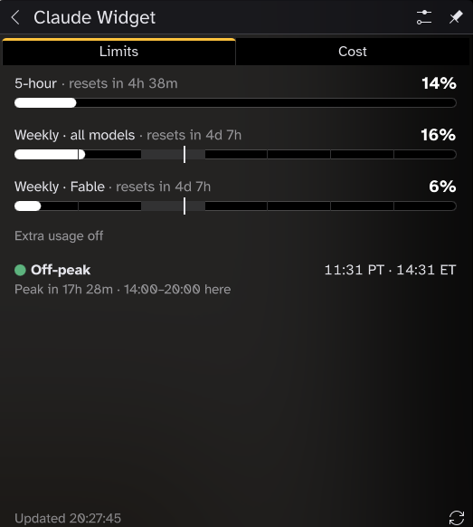

# Claude Widget

A KDE Plasma 6 panel widget that shows your Claude Code usage limits, your pace against them, and what your use would cost at API prices.

Based on [Claude Meter](https://github.com/p3kj/plasma-applet-claudemeter) by p3kj (MIT). This version adds a plain percent panel style, a place in the System Tray, automatic sign-in renewal, the Claude desktop app's numbers as a fallback, a Cost tab and a peak hours clock. It has its own widget ID, so it installs next to Claude Meter without a clash.

<p>
  
  
  
</p>

## Features

- Displays the 5-hour and 7-day (all models) rate limit windows
- Adds a separate bar for every scoped weekly limit the API reports (e.g. Fable), discovered dynamically so new models and plan tiers work without an update
- Optional pace on the weekly bars: each is split into its days, a marker tracks the current time, and usage past the marker is drawn in the warning color
- Three panel styles: the percent only (default), stacked bars, or a circular gauge
- A Cost tab with what your Claude Code use would cost at API prices, and a peak hours clock
- Configurable warning/critical thresholds with color coding
- Customizable bar colors
- Auto-refreshes on a configurable polling interval
- Warning icon when the sign-in is missing or the API returns an error
- Plans without a 5-hour limit (Ultra) show no 5-hour bar

## How it works

1. Reads the OAuth token from `.credentials.json`, created by the Claude Code CLI when you sign in. It checks `$CLAUDE_CONFIG_DIR` first when that variable is exported, then `~/.claude`, then a single `~/.claude*` sibling folder if exactly one has credentials. Setting **Claude folder** in the widget overrides all of it. The Cost tab and the sign-in window use the same folder, and each folder has its own cache files
2. Calls `GET https://api.anthropic.com/api/oauth/usage` with a bearer token
3. Parses the response for the 5-hour and 7-day windows, plus every scoped weekly limit in the `limits` array that has a reset time or non-zero utilization (the older top-level `seven_day_*` fields are still read as a fallback)
4. The token stays inside the Python helper and is never put on a command line, where other programs could read it

> **Note:** This widget uses an internal Anthropic API endpoint that is not part of the public API documentation. It may change or stop working without notice.

## Requirements

- KDE Plasma 6
- Claude Code CLI with an active subscription (Pro or Max)
- `python3` (standard library only)

## Install

```sh
git clone https://github.com/Tokra110/claude-widget-kde.git
cd claude-widget-kde
python3 install.py
```

Then add the "Claude Widget" widget to your panel or System Tray. `install.py` restarts the Plasma shell once, so the panel flickers.

## Uninstall

```sh
python3 install.py --remove
```

## Configuration

Right-click the widget and select "Configure...". The settings are in five sections:

- **Panel**
  - **Style** - percentage only (default), stacked bars, or a gauge
  - **Shows** - the 5-hour limit, the weekly limit for all models, or the top scoped weekly limit
  - **Inner ring** and **Gauge label** - for the gauge style: a second, thinner ring for another limit, and the text inside it
  - **Text color** - by usage level, the panel's own text color, or a custom color for light and dark panels
- **Popup**
  - **Limits** - which limits the Limits tab shows; scoped weekly limits (for example Fable) are listed once the widget has seen them
  - **Pace against the weekly limits** - split each weekly bar into its days and mark the current time; usage past the mark shows in the warning color as "Ahead of pace" (default: off)
  - **Peak hours clock** - the clock on the Limits tab (default: on)
  - **Cost tab** - show it (default: on); off hides it and deletes its cache. **Cost tab opens on** Today (default) or the last period you picked
- **Warning levels** - from which percent a limit shows as warning (default: 50) and critical (default: 80)
- **Colors** - the normal color for dark and light panels, and the warning color; critical uses the theme's red
- **Account**
  - **Claude folder** - another Claude config folder (default: `~/.claude`), useful with several accounts through `CLAUDE_CONFIG_DIR`, for example `~/.claude-personal`. Add one widget per account to watch them side by side
  - **Renew it automatically when it expires** - renew an expired sign-in by itself (default: on)
  - **Update at most every** - the smallest gap between two automatic fetches (default: 300 s). While Claude Code works on this computer the widget fetches once per gap, about 15 seconds after new activity; with no activity, every third gap. The refresh button always fetches at once

## Cost tab

The popup has a second tab, **Cost**. It shows what your Claude Code use would cost at API prices, for a period you pick (today, this week, last week, this month, last 30 days, last 90 days, all time), split by model.

- Click a model row to show only that model, and a day bar to show only that day; click it again, or the funnel button left of the period picker, to show all. Hover marks what a click picks. "Today" shows its hours, with the last 7 days below; "Last 30 days" and "Last 90 days" are whole days, today included.
- It reads the session logs in `<Claude folder>/projects/`, so it covers Claude Code on this computer only (the CLI and the desktop app's Code tab), not the Claude chat or other computers.
- About 20 seconds after the widget starts, it counts all logs once in the background at low priority, so the first count is fast. After that it counts each time you open the popup (before you click the tab, so switching tabs is instant) and when you press refresh on the tab. The process ends when it is done, and the tab is unloaded when the popup closes. The tab opens on "Today" (or the last period you picked, if set); it counts that period first, then all periods, so switching the period is instant afterwards.
- Each reply's numbers are cached in `~/.cache/claude-widget-kde/cost/`, one file per Claude folder (tens of MB with heavy use). The logs only grow, so a later count reads only the new lines. Delete the folder to count from scratch.
- Claude Code logs each reply several times while it writes it, and the early copies have a partial output count. The widget counts the copy with the most output tokens, so its totals can be a little higher than ccusage's, which counts the first copy.
- Turn the tab off in the settings (**Popup: Cost tab**) if you do not want it. That also deletes its cache, and the widget no longer counts your logs. (It still looks at the time of the newest log, to fetch the limits soon after you use Claude Code.)
- The counting rules and the price table come from [ccusage](https://github.com/ryoppippi/ccusage) (MIT License, Copyright (c) 2025 ryoppippi). A new model shows its tokens with no cost until its price is added to `contents/scripts/cost_report.py`.
- Tests: `python3 tools/test_cost_report.py`.

## Peak hours

The Limits tab shows a clock in US Pacific and Eastern time, with a colored dot for how fast the 5-hour limit drains now, how long until the next peak (or until the current one ends), and the peak window in your own time. The rule is in `contents/ui/peak.js` (tests: `node tools/test_peak.js`).

| Dot | When (Pacific time) | What is known |
|---|---|---|
| Red, "Peak hours" | Weekdays 05:00-11:00 (13:00-19:00 UTC in winter, 12:00-18:00 in summer) | **Official.** Anthropic, 26 March 2026: the 5-hour limit drains faster for Free, Pro and Max; weekly limits do not change. About 7% of users would hit a session limit they did not hit before, mostly on Pro. No multiplier was published. |
| Yellow, "US working hours" | Weekdays 04:00-05:00 and 11:00-17:00 | **Anecdotal only.** No extra drain is announced. Users report slow answers, errors and retries in the US working day, and retries after errors can cost usage. |
| Green, "Off-peak" | All other hours, and all weekend | Normal drain. |

What changed since, and how sure it is:

- **6 May 2026 (official):** Anthropic removed the peak-hours reduction for **Claude Code on Pro and Max** and doubled Claude Code's 5-hour limits for Pro, Max, Team and seat-based Enterprise. So red does not apply to Claude Code on those plans.
- **Claude chat (web, desktop, phone) and Free:** no end of the peak rule was announced, so trackers assume it still applies. Anthropic's help pages do not say either way. The 5-hour limit is shared, so chat at peak still uses more of the same limit.
- **30 October 2026:** Max 20x was renamed Ultra. Verified Ultra accounts have no 5-hour limit, so peak hours do not matter there.
- **13-28 March 2026:** a promotion doubled 5-hour usage outside weekdays 08:00-14:00 ET (05:00-11:00 PT). It ended, but it is where this window first appeared.
- **Late March 2026:** much of the "limits drain much too fast" talk at that time was a separate problem (prompt-cache bugs, retries), which Anthropic said it was looking into. It was not about the time of day.
- Some trackers give the window as 13:00-19:00 UTC all year. That is the same as 05:00-11:00 PT in winter, but one hour off in summer. This widget follows Pacific time, as the announcement did.

Sources: [The Register, 26 Mar 2026](https://www.theregister.com/software/2026/03/26/anthropic-tweaks-claude-usage-limits-to-manage-capacity/5225406), [TechRadar](https://www.techradar.com/ai-platforms-assistants/claude/claude-is-limiting-usage-more-aggressively-during-peak-hours-heres-what-changed), [PiunikaWeb, 27 Mar 2026](https://piunikaweb.com/2026/03/27/anthropic-explains-claude-usage-limits-peak-hours/), [Anthropic, higher limits and SpaceX compute (May 2026)](https://www.anthropic.com/news/higher-limits-spacex), [Claude help: March 2026 usage promotion](https://support.claude.com/en/articles/14063676-claude-march-2026-usage-promotion), [Claude help: Ultra plan](https://support.claude.com/en/articles/17728952-what-is-the-ultra-plan), [usagemeter.app](https://usagemeter.app/en/blog/claude-ai-peak-hours-surge-pricing-explained), [isitclaudetime.com](https://isitclaudetime.com/en/blog/when-are-claudes-peak-hours), [promoclock.co](https://promoclock.co/en/blog/claude-peak-hours/), [The Register, 31 Mar 2026](https://www.theregister.com/2026/03/31/anthropic_claude_code_limits/), [claude-code issue #41930](https://github.com/anthropics/claude-code/issues/41930). Checked on 15 November 2026; the trackers are third-party and partly disagree.

## Troubleshooting

- **Widget shows a warning icon** - make sure you are signed into the Claude Code CLI (`claude` in a terminal). The widget reads your OAuth token from `~/.claude/.credentials.json`, which is created on sign-in.
- **"No .credentials.json in ..."** - the sign-in token file is not where the widget looked. Note that `~/.claude.json` is *not* it: that file only holds account metadata (email, organization, plan), never the token. Common causes:
  - You set `CLAUDE_CONFIG_DIR` in your shell profile. plasmashell does not read your shell profile, so put the same path into the widget's **Claude folder** setting (or export the variable session-wide, e.g. in `~/.config/plasma-workspace/env/`).
  - You authenticate with `ANTHROPIC_API_KEY`, `ANTHROPIC_AUTH_TOKEN`, `apiKeyHelper`, Bedrock, Vertex, or Foundry instead of `claude /login`. No credentials file is written in those setups, and the widget cannot work from those credentials: `/api/oauth/usage` is subscription-scoped and needs an OAuth bearer token carrying the `user:profile` scope, which a Console API key does not have. A `claude setup-token` credential does not help either, since [it can only make model requests](https://code.claude.com/docs/en/authentication#generate-a-long-lived-token). Sign in with `claude` to get a token the widget can use.
  - You signed out and have not signed back in.
- **"Several accounts found ..."** - two or more `~/.claude*` folders each hold credentials, and the widget will not guess between them. Set **Claude folder** to the one you want. Add a second widget instance pointed at the other folder to watch both.
- **"Numbers from the Claude desktop app"** - the CLI sign-in could not be used, so the widget shows the 5-hour and weekly percentages the Claude desktop app writes to `~/.config/Claude/plan-usage-history.json` about every 15 minutes while it runs. Samples older than 45 minutes are not used. The desktop app's own sign-in stays in the system keyring; the widget never reads it.
- **"Your Claude sign-in has expired"** - the stored refresh token is dead, so only a new sign-in helps. Press the refresh button in the popup: it opens a terminal with `claude auth login`, and the widget fetches again when you close it. Or run `claude auth login` yourself.
- **No data after install** - the widget fetches once at start; after that, wait for the next update (default 5 minutes), or press the refresh button.
- **429 "Too Many Requests" errors** - the Anthropic API rate-limits usage polling. The default 5-minute gap should be safe, but if you set a very short gap you may get throttled; the widget then doubles the gap, up to four times the setting. Increase the interval in the widget configuration if this happens.

## Development

The code is QML (with its JavaScript) for what you see, and Python with only the standard library for everything behind it: `contents/scripts/` holds the fetch, sign-in and cost helpers, `install.py` installs, and `tools/release.py` checks and releases.

```sh
python3 tools/release.py check      # metadata, config, tests and QML syntax, then build dist/
python3 install.py                  # install into the running session and restart plasmashell
plasmawindowed com.github.tokra110.claudewidget   # open the widget in its own window
```

`install.py` restarts plasmashell on purpose: after a reinstall the panel keeps running
the previously cached QML, so a plain package update can look like your change did nothing.

### Releasing

Record changes as you go, then cut the release:

```sh
python3 tools/release.py note "Add a thing"   # a bullet under "## Unreleased" in CHANGELOG.md
python3 tools/release.py release minor        # patch | minor | major, or an explicit 1.0.0
```

`release` runs the preflight checks (on `master`, no stray changes, in sync with the
remote, tag unused, `gh` signed in), runs the checks, shows what it is about to do and
asks for confirmation. It then writes the version into `metadata.json`, dates the
changelog section, builds `dist/claude-widget-kde-<version>.plasmoid`, commits, creates an
annotated tag, pushes, and publishes a GitHub release with the archive attached.

An uncommitted `CHANGELOG.md` is fine, because the release commit picks it up. An
untracked file *inside* the packaged set stops the release, because it would otherwise
ship without ever being committed.

`--dry-run` commits and tags locally but does not push. Undo it with
`git tag -d v<version> && git reset --hard HEAD~1`.

The widget is not on the KDE Store yet. When it is, put its product number in
`STORE_ID` in `tools/release.py`; the release then ends with the store upload steps
(the store has no upload API).

## License

[MIT](LICENSE). Copyright (c) 2026 p3kj (Claude Meter) and Tokra110.
