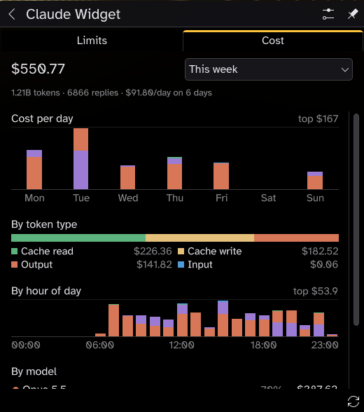
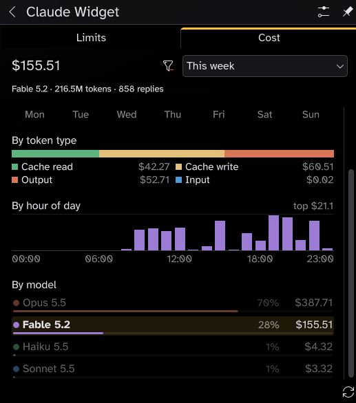

# Claude Widget

A KDE Plasma 6 panel widget for your Claude Code usage: the 5-hour and weekly limits, when they reset, and what your use would cost at API prices.

It started as [Claude Meter](https://github.com/p3kj/plasma-applet-claudemeter) by p3kj (MIT) and adds a percent-only panel style, System Tray support, automatic sign-in renewal, a Cost tab and a peak hours clock. It has its own widget ID, so both can be installed side by side.

<p>
  
  
  
</p>

## Features

- The 5-hour limit, the weekly limit, and a bar for each per-model weekly limit the API reports (Fable, for example). New limits show up without an update.
- Three panel styles: percent only (default), stacked bars, or a gauge.
- Optional pace marker on the weekly bars.
- A Cost tab: your Claude Code use at API prices, by period, day, hour, model and token type.
- A peak hours clock.
- Warning and critical colors at levels you set.

## Requirements

- KDE Plasma 6
- Claude Code, signed in with a Claude subscription
- `python3` (standard library only)

## Install

Download `claude-widget-kde-<version>.plasmoid` from [Releases](https://github.com/Tokra110/claude-widget-kde/releases). Then right-click the panel, choose **Add Widgets... > Get New Widgets... > Install Widget From Local File...** and pick the file. Or from a terminal:

```sh
kpackagetool6 -t Plasma/Applet -i claude-widget-kde-<version>.plasmoid
```

From source:

```sh
git clone https://github.com/Tokra110/claude-widget-kde.git
cd claude-widget-kde
python3 install.py
```

`install.py` restarts the Plasma shell once, so the panel flickers. Then add "Claude Widget" to the panel or the System Tray.

To uninstall: `python3 install.py --remove`.

## How it works

The widget reads the sign-in that Claude Code keeps in `~/.claude/.credentials.json` and asks Anthropic's usage endpoint (`/api/oauth/usage`) for your limits. It renews an expired sign-in the same way Claude Code does and writes the new one back. The token stays inside a Python helper and never appears on a command line.

The endpoint is internal and undocumented, so it can change or stop working without notice.

## Settings

Right-click the widget and choose **Configure...**.

- **Panel:** style, which limit it shows, gauge options, and text color.
- **Popup:** which limits to list, the weekly pace marker (off by default), the peak hours clock, and the Cost tab with the period it opens on.
- **Warning levels:** warning from 50 % and critical from 80 % by default.
- **Colors:** the normal color for dark and light panels, and the warning color. Critical uses the theme's red.
- **Account:**
  - **Claude folder:** set this if your sign-in is not in `~/.claude` (for example with `CLAUDE_CONFIG_DIR`). For several accounts, add one widget per folder.
  - **Automatic sign-in renewal**
  - **Update at most every:** default 300 s. While Claude Code is busy on this computer, the widget updates once per interval; when it is idle, every third interval.

## Cost tab

The Cost tab shows what your Claude Code use on this computer would cost at API prices. It reads the session logs in `<Claude folder>/projects/`, so it does not cover Claude chat or other computers.

- Pick a period: today, this week, last week, this month, the last 30 or 90 days, or all time. Click a model or a day to filter; click it again, or the funnel button, to clear the filter.
- The first full count runs in the background at low priority about 20 seconds after the widget starts. After that, the widget counts when you open the popup and reads only the lines added since the last count. The cache is in `~/.cache/claude-widget-kde/cost/`, one file per Claude folder.
- Claude Code writes each reply to the log several times, and the early copies have a partial output count. The widget counts the copy with the most output tokens, so its totals can be slightly higher than [ccusage](https://github.com/ryoppippi/ccusage)'s. The other counting rules and the price table come from ccusage (MIT, Copyright (c) 2025 ryoppippi).
- A model with no known price counts as $0, and the tab says so. Prices are in `contents/scripts/cost_report.py`.
- Turning the tab off in the settings deletes its cache, and the widget stops counting your logs.

## Peak hours

The Limits tab shows the time in US Pacific and Eastern time, a colored dot for the current period, and how long until the next peak or until the current one ends.

| Dot | When (Pacific time) | Status |
|---|---|---|
| Red, "Peak hours" | Weekdays 05:00-11:00 | Official. Since 26 March 2026, the 5-hour limit drains faster at these hours. |
| Yellow, "US working hours" | Weekdays 04:00-05:00 and 11:00-17:00 | Anecdotal only: users report slow answers and errors. |
| Green, "Off-peak" | All other hours and weekends | Normal drain. |

Since 6 May 2026, the faster drain no longer applies to Claude Code on Pro and Max. It still applies to Claude chat and the Free plan, and the 5-hour limit is shared. Ultra accounts have no 5-hour limit.

Sources (checked 15 November 2026): [The Register](https://www.theregister.com/software/2026/03/26/anthropic-tweaks-claude-usage-limits-to-manage-capacity/5225406), [Anthropic, May 2026](https://www.anthropic.com/news/higher-limits-spacex), [Claude help: Ultra plan](https://support.claude.com/en/articles/17728952-what-is-the-ultra-plan), [claude-code issue #41930](https://github.com/anthropics/claude-code/issues/41930).

## Troubleshooting

- **"No Claude sign-in found":** run `claude` in a terminal and sign in. If you use `CLAUDE_CONFIG_DIR`, put the same path in **Claude folder**: Plasma does not read your shell profile. API keys, `claude setup-token`, Bedrock and Vertex do not work, because the usage endpoint needs a subscription sign-in.
- **"Several Claude accounts found":** set **Claude folder** to the account you want.
- **"Your Claude sign-in has expired":** press the refresh button. It opens a terminal with `claude auth login`, and the widget updates when you close it.
- **"Numbers from the Claude desktop app":** the Claude Code sign-in could not be used, so the widget shows the percentages that the Claude desktop app saves about every 15 minutes, if they are less than 45 minutes old.
- **"Anthropic asks the widget to wait":** too many requests. The widget waits longer between updates, up to four times the setting.

## Development

QML for the interface, and Python (standard library only) for everything else.

```sh
python3 tools/release.py check    # tests, metadata and QML syntax, then builds dist/
python3 install.py                # install and restart plasmashell
plasmawindowed com.github.tokra110.claudewidget   # open the widget in its own window
```

To release, add notes with `python3 tools/release.py note "..."`, then run `python3 tools/release.py release patch` (or `minor`, `major`, `X.Y.Z`). It checks the repo, asks before it acts, then tags the release and publishes it on GitHub with the `.plasmoid` file. `--dry-run` stops before the push.

## License

[MIT](LICENSE). Copyright (c) 2026 p3kj (Claude Meter) and Tokra110.
